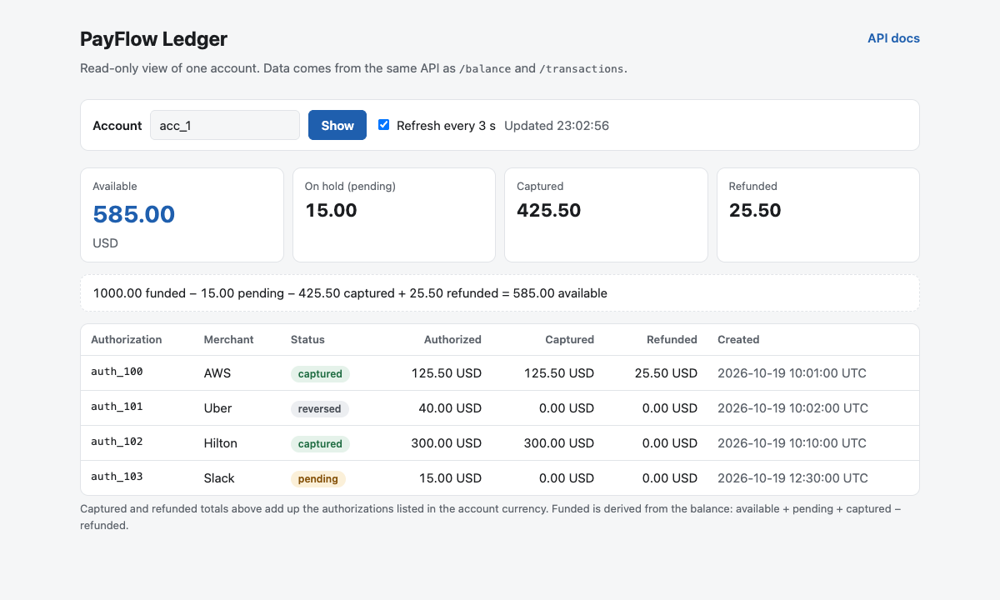

<h1 align="center">PayFlow Ledger</h1>

<p align="center">
  Receives PayFlow corporate card webhooks and keeps the books: what is available, what is on hold, and where every authorization stands.<br>
  Signed, idempotent and order-independent, whatever order and however many times PayFlow delivers.
</p>

<p align="center">
  <a href="https://github.com/OleksiukStepan/payflow-ledger/actions/workflows/ci.yml"></a>
  
  
  
</p>

<p align="center">
  
</p>

## Quick start

```bash
docker compose up --build
```

The service listens on http://localhost:8000 and migrates its schema on start.

| Open | What it is |
|---|---|
| http://localhost:8000/ | read-only page of one account: balance, the formula written out, every authorization; refreshes every 3 s |
| http://localhost:8000/docs | Swagger: how to sign a webhook, an example body per event type, every possible answer |

Send the provider's events with the sender from [mekasp/PayFlow](https://github.com/mekasp/PayFlow):

```bash
python3 PayFlowEventsSender.py happy_path.json
curl localhost:8000/accounts/acc_1/balance
# {"account_id":"acc_1","currency":"USD","available":"585.00","pending":"15.00"}
```

### Verify in one command

PayFlow's sender delivers events one by one, in file order. The PayFlow docs promise something harsher: duplicates, any order, parallel requests. `scripts/replay.py` (standard library only, like the sender) delivers that way and checks the result:

```bash
make verify
```

```
Delivered 43 requests (38 from files + 5 extra) in 0.20s
Seed 486731 (pass --seed 486731 to reproduce the same order)
Answers: duplicate 10, ignored 1, ok 32

subject    field         expected     actual
acc_1      available       585.00     585.00
acc_1      pending          15.00      15.00
auth_100   status        captured   captured
...
58/58 checks match
```

It starts the stack, sends every event file shuffled, with five extra copies, from 16 threads, and compares all balances and authorizations with `scenarios/expected.json`; any mismatch or failed delivery exits 1. Run it again on the same database and every answer is `duplicate` with the same 58/58. CI does both on every push. The flags work on any file: `python3 scripts/replay.py --help`.

### Tests

```bash
docker compose run --rm --build tests      # or: make test
```

63 tests run against a real PostgreSQL (a separate `payflow_test` database that every run drops, recreates and migrates), because the guarantees under test (`ON CONFLICT`, `NUMERIC`, concurrent transactions) are PostgreSQL behaviour:

- signature, body cap and validation, secret rotation;
- every ledger rule from the PayFlow docs and the assumptions below;
- the happy path reversed, twice and in 50 seeded shuffles with duplicates, and from 16 threads at once;
- **property-based tests** ([Hypothesis](https://hypothesis.readthedocs.io)): random account histories delivered in random order with random repeats must equal an in-order delivery, and `available` must always equal the formula. They were checked against deliberately broken code: the shrunk counterexample for "created overwrites a reversal" is a 0.01 hold that comes back after its reversal arrived first;
- the scenario files against `scenarios/expected.json`, the API docs and the dashboard's security headers.

Outside Docker: `pip install -e ".[dev]"`, point `DATABASE_URL` at a database whose name ends in `_test` (the suite drops and recreates it, and refuses any other name) and run `pytest`.

### Event files

| File | What it delivers | Expected |
|---|---|---|
| `tests/fixtures/happy_path.json` | the provider's happy path on `acc_1` | 585.00 available, 15.00 pending |
| `scenarios/shuffled_duplicates.json` | the happy path on `acc_2`, shuffled, four events twice | 585.00 available, 15.00 pending |
| `scenarios/edge_cases.json` | `acc_3`: events before the first funding, capture above and below the hold, partial reversal, capture racing a reversal, two refunds and a re-sent one, an unknown event type, a EUR authorization | 555.00 available, 0.00 pending |

All of them also work with PayFlow's own sender. Full expectations per authorization: `scenarios/expected.json`.

## API

| Endpoint | Answers |
|---|---|
| `POST /webhooks` | `200 {"status": "ok"}` applied, `200 {"status": "duplicate"}` already applied, `200 {"status": "ignored"}` unknown type (stored), `400` invalid payload, `401` bad or missing signature, `413` body over 64 KB |
| `GET /accounts/{id}/balance` | `200` with `available` and `pending` as two-decimal strings, `404` for an unknown account |
| `GET /accounts/{id}/transactions` | `200` with every authorization of the account and its current state, `404` for an unknown account |
| `GET /` | the read-only account page |
| `GET /docs`, `/openapi.json` | API documentation |
| `GET /health` | `200`, used by the compose healthcheck |

`available = funded − pending − captured + refunded`, all in the account currency.

Configuration: `WEBHOOK_SECRET` (required, never empty), `WEBHOOK_SECRET_PREVIOUS` (optional, the secret being rotated out), `DATABASE_URL`. See `.env.example`.

## Assumptions

Where the assignment and the PayFlow docs are silent, the service does the following.

- **An account exists from its first `account.funded`.** Events that arrive earlier are stored and applied; both GET endpoints answer 404 until the funding arrives, then everything counts.
- **The account currency is the currency of the first funding that arrives.** Events in another currency are stored and listed in transactions, but left out of the balance and logged as a warning. No conversion.
- **Capture wins over reversal.** The lifecycle says an authorization is either captured or reversed; with out-of-order delivery both facts can still show up. Money that was taken is the stronger fact, and the conflict is logged.
- **A reversal releases the whole hold**, even when its amount is smaller than the authorization (the docs say the hold is released and nothing is charged). The amount is kept for audit.
- **Refunds count as they come**: before the capture arrives, or above the captured amount. The task defines `refunded` as the sum of all refunds; the order is not guaranteed, so they are not validated against the capture. A refund re-sent under a new event id counts once (`refund_id` is unique).
- **`available` may go negative.** PayFlow approves operations, not us; the ledger records what happened.
- **A valid signature with an invalid payload answers 400.** It is a contract violation, not an attack; PayFlow keeps retrying, which is visible on both sides and harmless because processing is idempotent. Nothing is stored for it. (See the Stripe comparison below for the trade-off.)
- **Unknown event types answer 200** and are stored, so they can be replayed once supported. Unknown fields are ignored (forward compatible).
- **`authorization_id` and `refund_id` are unique across accounts**; a redelivery with the same event `id` is the same event, its content is not compared.
- **Amounts are strings with exactly two decimals** (`^\d{1,12}\.\d{2}$`), as the docs specify; a JSON number or `"12.5"` is rejected. `merchant` is optional.
- **Transactions are sorted by the authorization's `created_at`**; an authorization known only from a capture or reversal has `merchant`, `authorized_amount` and `created_at` set to `null` until `authorization.created` arrives, and is listed last.

## Key decisions

**Exactly-once effect on top of at-least-once delivery.** Every event is inserted into `events` with its PayFlow `id` as the primary key (`INSERT ... ON CONFLICT DO NOTHING RETURNING id`) in the same transaction that applies it. No row returned means a duplicate: answer 200 and stop. If anything fails midway, the transaction rolls back together with the event row, PayFlow retries and processing starts clean. Concurrent duplicates are serialized by the primary key itself: the second insert waits for the first transaction and then does nothing.

**Facts, not transitions.** An event never says "move to captured"; it records a fact in the authorization's own column: `authorized_amount` (created), `captured_amount`, `reversed_amount`. Each event type writes only its columns through an atomic upsert, so reordered or parallel events cannot overwrite each other. The status is a PostgreSQL generated column (`captured` if a capture exists, else `reversed`, else `pending`), so the result is the same for every delivery order, which the property-based tests check on random histories.

**No stored balance.** A running balance column needs a read-modify-write on every event and loses updates under parallel delivery unless every event locks the account. Instead the balance is four `SUM`s in one statement, which also makes it one consistent snapshot. Reads cost one indexed scan of the account's rows; see production notes for when to change that.

**Signature over the raw bytes, before anything else.** The body is read with a 64 KB cap, the HMAC-SHA256 is computed over exactly those bytes and compared in constant time (`hmac.compare_digest`, on bytes so a non-ASCII header cannot crash it). Re-serializing parsed JSON would change spacing or key order and break the signature. During a rotation both secrets are checked, always both, so timing does not reveal which one matched.

**Money is `Decimal` and `NUMERIC(14,2)`, never float.** Amounts must arrive as strings: a JSON number has already been through a float by the time it is parsed. The dashboard adds amounts in integer cents for the same reason.

**Webhook data is untrusted on the page too.** Merchant names arrive in webhooks, so the dashboard only writes API values into the page with `textContent`, a test forbids HTML sinks in its script, and the page is served with a Content-Security-Policy that allows no inline script and no other origin. A merchant called `` shows up as that text.

**FastAPI + SQLAlchemy 2 (sync) + Alembic.** Three endpoints do not need Django's machinery, and the PostgreSQL-specific upsert (`insert().on_conflict_do_update()`) is first-class in SQLAlchemy, while Django's `update_or_create` is not atomic under concurrency. The DB layer is synchronous and runs in FastAPI's thread pool: simpler to read and test, and the database is the bottleneck anyway.

**Fast, synchronous processing.** One short transaction per webhook takes milliseconds (0.2 s worst case with 24 parallel senders locally), well inside PayFlow's 10 s budget, so there is no queue to operate.

## Compared with Stripe's current webhook guidance

PayFlow is modelled on card-issuing providers, so the implementation was checked against Stripe's webhook and Issuing documentation as of October 2026. PayFlow's own format (body-only signature, no events API) limits what applies.

| Stripe practice | Here |
|---|---|
| Verify an HMAC-SHA256 over the raw body in constant time ([webhooks](https://docs.stripe.com/webhooks)) | Same. |
| Sign a timestamp with the body and reject events older than 5 minutes ([replay attacks](https://docs.stripe.com/webhooks)) | Not possible: PayFlow signs the body only. A replayed event is a harmless duplicate; a timestamped signature is the first thing to ask PayFlow for. |
| Roll the signing secret with the old one valid for up to 24 h ([roll secrets](https://docs.stripe.com/webhooks)) | `WEBHOOK_SECRET_PREVIOUS`. |
| Only 2xx counts; anything else is retried for up to 3 days, and an endpoint that keeps failing for several days is disabled ([retries](https://docs.stripe.com/webhooks), [support](https://support.stripe.com/questions/why-is-stripe-trying-to-reach-my-webhook-endpoints)) | 2xx for everything stored, unknown types included. The one deliberate 4xx with a valid signature is 400 for an invalid payload; if the provider disables endpoints the way Stripe does, a steady stream of them could switch the endpoint off, so production should store such payloads in a dead-letter table and answer 2xx. |
| Return 2xx quickly, process asynchronously ([best practices](https://docs.stripe.com/webhooks)) | Processing is one millisecond-scale transaction before answering, which keeps the guarantee simple (answered means stored). A queue becomes worth it under real load. |
| Deduplicate by event id; the same change can occasionally produce two events, so deduplicate by object too ([duplicates](https://docs.stripe.com/webhooks)) | Event id is the primary key; refunds are also unique by `refund_id`; authorization facts are idempotent per authorization. |
| Do not rely on order; fetch the current object when an event arrives early ([event ordering](https://docs.stripe.com/webhooks)), which is also why Stripe now recommends thin events ([how events work](https://docs.stripe.com/events/how-events-work)) | PayFlow has no API to fetch from, so the ledger is built to be order-independent from the payloads alone. |
| Allowlist Stripe's webhook IPs as well as verifying signatures ([IPs](https://docs.stripe.com/ips)) | PayFlow publishes no IP ranges; add an allowlist at the edge if it does. |
| Reconcile missed events through the events API, kept for 30 days ([manage endpoints](https://docs.stripe.com/events/manage-webhook-endpoints)) | Needs a PayFlow events API; listed under production work. |

Real issuing models are richer than PayFlow's docs ([authorizations](https://docs.stripe.com/issuing/purchases/authorizations), [transactions](https://docs.stripe.com/issuing/purchases/transactions)): several captures per authorization, captures with no authorization at all, refunds not linked to an authorization, partial reversals that keep the hold open, and an `expired` status. The fact-per-column model extends to those by moving captures and reversals into their own tables keyed by the provider's transaction id, the way refunds already are; it already accepts a capture whose authorization never arrived.

## Not done, on purpose

- **No authentication on the read endpoints or the page.** The assignment does not ask for it; anyone who can reach the service can read any balance.
- **No replay protection beyond the event id**, see the Stripe comparison.
- **No queue or worker**, see above.
- **No tooling to replay stored unknown events** or to inspect rejected payloads (their validation errors are logged, the bodies are not stored).
- **No pagination**, as the assignment says.

## Before production

- Load the webhook secret from a secret manager; rotate with `WEBHOOK_SECRET_PREVIOUS`.
- Ask PayFlow for a timestamped signature (Stripe-style `t=...,v1=...`) and reject requests older than a few minutes.
- Authenticate the read endpoints and the page, and check that the caller may see the account; rate-limit `/webhooks`; allowlist the provider's IPs if published.
- Store rejected payloads in a dead-letter table, answer 2xx for them, and add a replay command for them and for unknown event types.
- Reconcile against PayFlow's API on a schedule: webhooks can be lost after 72 hours of failed retries.
- Run migrations as a separate deploy step instead of on container start, so several replicas do not race.
- Structured JSON logs with the event id, metrics and alerts on 4xx rates and on the anomaly warnings (capture plus reversal, foreign currency).
- If accounts grow large: keep per-account totals updated in the same transaction (with a row lock on the account) or periodic snapshots, instead of summing on every read.
- Lock dependencies with hashes; run the app under a process manager with a sized connection pool.

## Project layout

See [ARCHITECTURE.md](ARCHITECTURE.md) for the code map, the data model and the invariants, and [CHANGELOG.md](CHANGELOG.md) for what changed.
